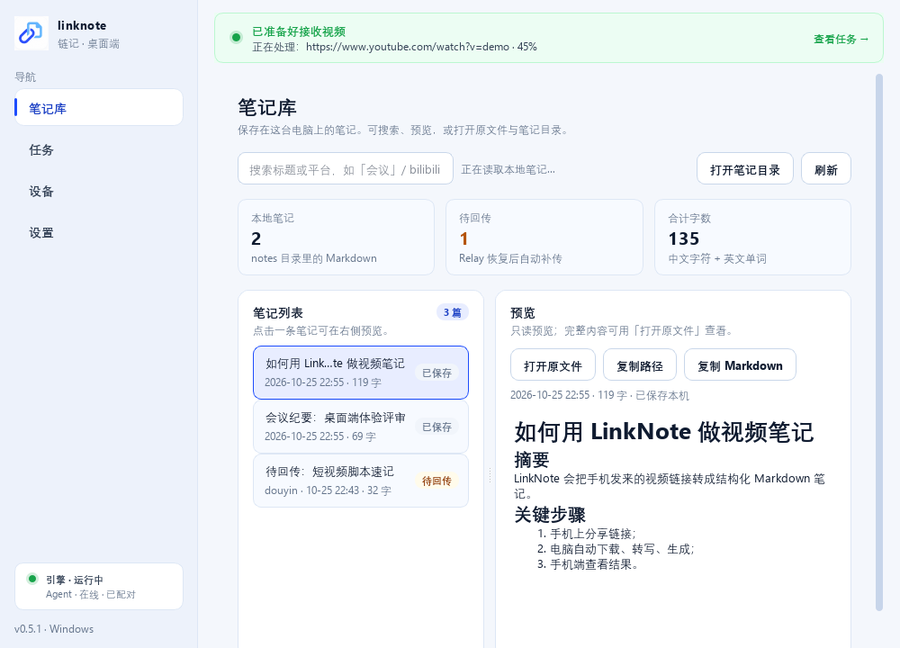
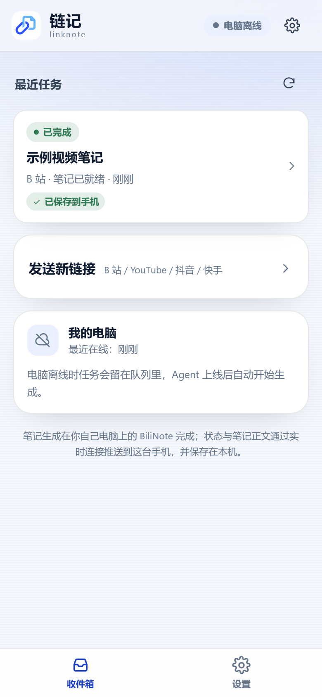

# LinkNote / 链记

手机或 Telegram 发一个视频链接，家里的 Windows 电脑自动下载、转写，并用你自己的 AI Key 生成 Markdown 笔记，回到手机或聊天里阅读。视频、转写和笔记都在你自己的电脑上。

**需要手机/PWA 时**：用你自己的 Cloudflare 账号 + 域名部署 Relay。
**只用 Telegram 时**：可以不部署 Relay，走本机「Telegram 本地模式」（没有手机/PWA）。

**当前版本：桌面 0.5.1 · PWA 0.4.0 · Android 1.3 · Relay 0.5.0**

## 功能

- **手机随手收集**：Android 分享菜单直接发链接，PWA 也支持粘贴；APK 带原生分享入口。
- **Telegram Bot**：填自己的 Bot Token，在聊天里发链接；完成后回预览 + 完整 `.md`，支持 `/status` `/last` `/retry`。**只用 Telegram 时可走本地模式，不需要 Relay**。
- **本地生成笔记**：Windows 电脑内置 BiliNote 引擎，下载 → ffmpeg → Whisper → 你的 LLM Key → Markdown；支持 B 站 / YouTube / 抖音 / 快手。
- **实时链路**：WebSocket 推送任务进度与笔记；断线自动重连；手机能看到“电脑在线 · 可生成 / 需要处理”。
- **笔记阅读与缓存**：Markdown 渲染、复制/下载/分享、收藏固定；手机本地缓存 30 篇 / 6MB，超出自动淘汰未收藏的旧笔记。
- **桌面客户端**：笔记库 / 任务 / 设备 / 设置 四个页面；系统托盘；首次向导；可把笔记自动归档到 Obsidian 或本地目录（自动补 YAML frontmatter）。
- **Relay 可选**：需要手机/PWA 时，用自己的 Cloudflare Worker + D1 + Durable Objects 部署，个人免费额度够用；没有公共服务器，也不内置作者的域名。只用 Telegram 时可完全不部署。
- **隐私**：LLM API Key、Telegram Bot Token 只存本机；Relay 只中转任务元数据和临时笔记正文，不持久保存笔记内容。
- **开源**：MIT。安装包内置 BiliNote 引擎（MIT）、PySide6（LGPL）、FFmpeg（LGPL），随包附带许可文本。

## 如何使用

### 0. 准备

- 一台常开的 Windows 10/11 电脑（不需要公网 IP）
- **需要手机/PWA**：一部 Android 手机 + 一个自己的 Cloudflare 账号/域名（部署 Relay）
- **只用 Telegram**：一个自己的 Telegram Bot Token（不需要 Cloudflare）
- 一个 LLM API Key（DeepSeek / OpenAI 等，费用由你自己承担）

### 1. 部署 Relay（需要手机/PWA 时）

LinkNote 不提供公共 Relay。按 [自托管 Relay](docs/self-hosting.md) 用你自己的 Cloudflare 账号和域名部署，得到一个类似 `https://relay.example.com` 的地址。

简要步骤：创建 D1 → 修改 `relay/wrangler.toml`（D1 id、域名）→ 应用 migration → 设置 `INTERNAL_SECRET` / `TICKET_SECRET` → `wrangler deploy` → 绑定自定义域名。完整命令和排错见文档。

**只用 Telegram 的人可以跳过这一步**：安装后只在设置里填 Bot Token，Relay 留空，Agent 会以“Telegram 本地模式”运行（没有手机/PWA）。

### 2. 安装 Windows 桌面端

从 Releases 下载：

- `LinkNote-Setup-0.5.1.msi`（推荐；151,522,696 B，SHA256 `07360BB3A31879B02A55454AF98D0A0EA0554910FEC87A81E73B6110C8C76CBB`）
- `LinkNote-Setup-0.5.1.exe`（备用；133,611,145 B，SHA256 `221B8600D5E6023A82E2F683259F978A7C35F2FBD41796C13D2EC615D770AD62`）

安装是 per-user、免管理员；升级保留 `%LOCALAPPDATA%\LinkNote` 数据。首次打开按向导完成：

1. 填写你自己的 Relay 地址，点“测试连接”
2. 下载 ffmpeg（LGPL shared）
3. 启动内置 BiliNote 引擎
4. 填 LLM API Key，选模型
5. 下载 Whisper 模型
6. 配对手机

关闭窗口即最小化到托盘；托盘菜单可以打开主界面、暂停 Agent、重启引擎或退出。

### 3. 手机端

- **PWA（推荐）**：手机浏览器打开你自己的 Relay 域名（如 `https://relay.example.com`）→ 输入配对码 → 浏览器菜单“安装应用”。之后 B 站/YouTube 的分享面板会出现「链记」。
- **APK**：从 Releases 下载 `LinkNote-debug-1.3.apk`（4,701,320 B，SHA256 `05F5B84E6902A1D51BB78CF712C96D774AA2A8F48DA9EAEA6C3FDA0985670F49`，versionCode 4 / versionName 1.3）。首次配对页要手动填写你自己的 Relay 地址。当前 APK 为 debug 签名，未做真机验证。

之后每次：分享/粘贴链接 → 等电脑生成 → 在手机阅读、复制、下载或分享 Markdown。

### 4. Telegram Bot（可选）

有两种模式：

- **本地模式（不需要 Relay）**：Relay 留空 + 启用 Telegram；Bot 在本机直接调用 BiliNote，完成后回 Telegram。**没有手机/PWA**。
- **Relay 模式**：已经部署并填了 Relay 时，Bot 走同一个 Relay 任务队列，和手机共用。

步骤：

1. 在 Telegram 找 `@BotFather`，`/newbot` 创建自己的 bot，复制 token。
2. 桌面 → 设置 → 消息入口 → 粘贴 token → 测试连接 → 启用 → 保存。
3. 打开 `t.me/你的bot` → `/start` → 直接发视频链接。
4. 处理完成后 bot 会发预览和完整 `.md`；用 `/status`、`/last`、`/retry` 管理任务。

详见 [Bot 链接入口](docs/bot-channels.md)。

### 5. 常见问题

- **只用 Telegram Bot，可以不要 Cloudflare Relay 吗？** 可以（v0.5.1+）：桌面设置里 Relay 留空、只启用 Telegram，Agent 进入“Telegram 本地模式”，直接本机处理并回 Telegram；代价是没有手机/PWA。需要手机时再按第 1 步部署 Relay。
- **桌面提示“未配置 Relay”**：如果只用 Telegram，请先在设置里启用 Telegram（token 非空）；否则先在向导或设置里填写你自己的 Relay，并用“测试连接”确认 `/api/v1/health` 正常。
- **手机显示电脑离线**：确认桌面 Agent 在运行、电脑没有休眠/断网；恢复后任务会继续。
- **PWA 还是旧界面**：关掉页面重开一次，让新的 Service Worker 接管。
- **安装包被 SmartScreen 拦截**：当前未做代码签名，点“更多信息 → 仍要运行”。
- **更多文档**：[使用指南](docs/user-guide.md) · [部署进阶](docs/deployment.md) · [发布报告](docs/v0.5-release-report.md) · [安全模型](docs/security.md) · [Android 打包](packaging/android/README.md)

---

License: MIT。BiliNote 为上游 MIT 项目，本项目不修改其源码；安装包内置其编译产物，第三方许可见 [NOTICE](NOTICE)。
