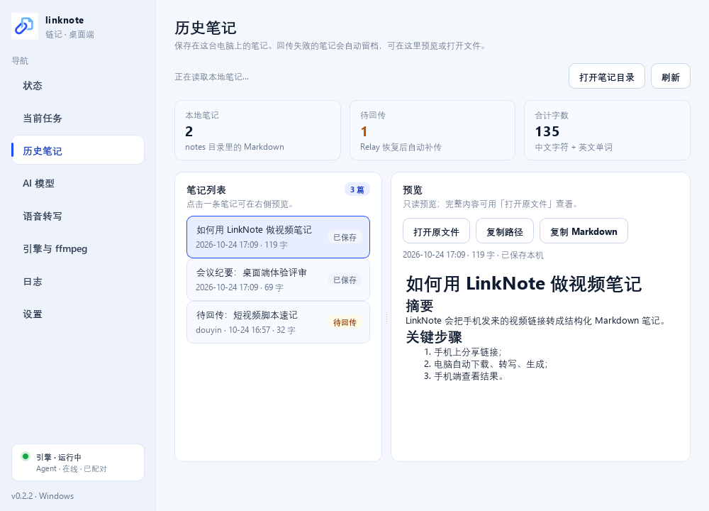

# LinkNote / 链记

手机分享视频链接 → 家里电脑的 BiliNote 生成 AI 笔记 → Markdown 回到手机。

> 工作名，可改名。定位：**BiliNote 的移动端远程入口**，不是另一个 BiliNote。
> 视频、音频、Whisper 模型、LLM API Key 全部留在你的电脑；云端只中转链接和任务状态，**笔记正文只在手机本地缓存，不落 D1**。

## 现在能跑什么

| 能力 | 状态 |
|---|---|
| Relay：配对/设备/任务 + Durable Objects WebSocket 推送（D1 只存元数据） | ✅ 46 项契约/实时测试通过 |
| PC Agent：配对、WebSocket 收任务、断线退避重连、笔记按需重发 | ✅ 206 项单测通过 |
| 手机 PWA：配对、分享/粘贴、实时进度、阅读器、笔记本地缓存、离线壳 | ✅ 10 项 Playwright 冒烟 + WS mock 全绿 |
| 真实链路：YouTube + B 站各生成一篇笔记 | ✅ 见 [E2E 报告](docs/e2e-report.md) |
| Windows 桌面客户端：托盘 + 自启 + 首次向导 + 内置引擎 + 历史/当前任务 | ✅ 57 项 UI smoke + 8 项 pytest |
| Android debug APK（Capacitor 壳 + ACTION_SEND） | ✅ 已构建；⚠️ 未真机验证 |
| 生产部署到 `relay.xykong.xyz` | ✅ 已部署到 Cloudflare（D1 APAC） |

## Windows 桌面客户端（推荐给普通用户）

给不想折腾命令行/API 路径的人：**一个安装包，内置 BiliNote 引擎**，首次打开走 7 步向导。
品牌已更新为蓝白配色 / 链条文档图标（`assets/brand/`）。

- 安装包（MSI，推荐）：`dist-desktop/LinkNote-Setup-0.2.2.msi`
  - 大小：151,403,617 字节（144.4 MB）
  - SHA256：`27224790573F455885B66D61B2921D44CD42AF3A9401540FE360614079135D72`
  - Windows Installer per-user 安装，免管理员；由安装服务创建 `%LOCALAPPDATA%\LinkNote` 数据目录，不经过 Inno 的临时解压，适合被联想电脑管家/火绒拦截的机器
- 安装包（EXE，备用）：`dist-desktop/LinkNote-Setup-0.2.2.exe`
  - 大小：133,492,705 字节（127.3 MB）
  - SHA256：`752F242B16FF01AB81C987DDC5F83081F4F8A9C8F61420D68153F4E881E645F7`
  - per-user 安装，免管理员，默认创建桌面/开始菜单快捷方式、默认开机自启
  - 内置 BiliNote 引擎（约 300 MB），不要求用户自己安装 BiliNote
- 主程序：`dist-desktop/LinkNote/LinkNote.exe`
  - SHA256：`41561E659652E7EAA0C2AA66EB687DD98C0B9D15C79D0BC97C5B45AA18A85720`
- 首次向导：ffmpeg 自动下载 → 启动引擎 → 填 LLM Key/选模型 → 下载 Whisper → 配对手机
- 常驻系统托盘；托盘显示绿/黄/红状态；开机自启；关闭窗口即最小化
- 详细说明：[desktop/README.md](desktop/README.md)、[打包说明](desktop/packaging/README.md)





### 最终 APK（手机端可选）

- 路径：`release/LinkNote-debug.apk`
- 大小：4,687,552 字节（4.47 MiB）
- SHA256：`C3C3229DDC46CA18BADC86AA1F15AB960A38BFC4F344222AA85619E7CF6F2D06`
- 构建时间：2026-10-24 16:32:04（Asia/Shanghai）
- 包名 `xyz.xykong.linknote`，versionCode 2 / versionName 1.1，label「链记」，minSdk 24 / targetSdk 36，debug 签名，`android:allowBackup="false"`
- 分享入口：系统分享 `text/plain` → App 内收件箱预填
- 构建/安装说明见 [packaging/android/README.md](packaging/android/README.md)


## 它怎么工作

```text
手机 PWA / APK ◀── WebSocket 推送 ──▶ Cloudflare Worker + Durable Object(SQLite)
        │                                │  Hibernation 长连接；D1 只存任务元数据
        │  REST 快照兜底                  │  presence / task_updated / note 转发
        ▼                                ▼
  手机本地缓存笔记 ◀── note ── PC Agent（WebSocket，断线退避重连）
                                       │ http://127.0.0.1:8483/api
                                       ▼
                        Windows 电脑上的 BiliNote（本机，不改代码）
                     yt-dlp → ffmpeg → Whisper/Groq → 你的 LLM Key → Markdown
```

电脑不需要公网 IP，路由器不用端口映射；手机在 4G/公司网络也能用。原理与取舍见 [架构](docs/architecture.md)。

## 快速开始

### 普通用户（Windows）

1. 双击 `dist-desktop/LinkNote-Setup-0.2.2.msi` 安装（推荐；EXE 为备用）。
2. 按首次配置向导完成：ffmpeg → 引擎 → LLM Key → Whisper → 手机配对。
3. 手机打开 `https://relay.xykong.xyz`（或安装 APK），输入配对码即可。

### 开发/本地联调

前置：Node.js 20+、[uv](https://docs.astral.sh/uv/)、本机 BiliNote 引擎（或 `desktop/build/engine`）。

```powershell
npm run setup          # 安装 relay/app 依赖、vendor、sync、本地 D1、pc-agent venv

# 1. 启动 Relay + PWA（保持运行）
npm run dev            # http://127.0.0.1:8787

# 2. 新开 PowerShell：开发模式桌面端（可不安装）
cd desktop
.venv\Scripts\python.exe -m linknote_desktop

# 或者用老式 CLI Agent：
cd pc-agent
.venv\Scripts\python.exe -m linknote_agent pair --relay http://127.0.0.1:8787
.venv\Scripts\python.exe -m linknote_agent run
```

想直接看真实生成的笔记：`assets/e2e/bilibili-note.md`、`assets/e2e/real-note.md`。

## 文档

- [桌面客户端说明](desktop/README.md)（安装/向导/架构/限制）
- [桌面端打包](desktop/packaging/README.md)
- [架构与取舍](docs/architecture.md)
- [实时协议（DO/WS）](docs/realtime-protocol.md)
- [接口契约](docs/api-contract.md)（Relay / Agent / PWA 三方唯一约定）
- [部署到 Cloudflare](docs/deployment.md)
- [使用指南（Windows + Android）](docs/user-guide.md)
- [安全模型](docs/security.md)
- [端到端验证报告](docs/e2e-report.md)
- [Android 打包说明](packaging/android/README.md)
- [PC Agent 说明](pc-agent/README.md)

## 仓库结构

| 目录 | 说明 |
|---|---|
| `desktop/` | Windows 桌面客户端（PySide6 + 托盘 + 首次向导 + 打包） |
| `relay/` | Cloudflare Worker + D1，配对/任务/笔记 API，同时托管 PWA |
| `pc-agent/` | Windows PC Agent，调用本机 BiliNote |
| `app/` | 手机 PWA（`app/www`，Capacitor `webDir`） |
| `app/android/` | Capacitor Android 工程（含 ACTION_SEND 分享接收） |
| `packaging/android/` | 工具链安装 + APK 构建脚本、补丁、验证记录 |
| `docs/` | 架构、接口、部署、安全、E2E 报告 |
| `scripts/` | 开发/同步/UI 冒烟/图标/端到端脚本 |
| `release/` | `LinkNote-debug.apk`（构建产物，不上 git） |

## 测试

```powershell
npm --prefix relay test          # Relay 契约 20 项（自动起 wrangler dev）
node scripts\ui-smoke.mjs        # PWA UI 10 项（需 relay 在 8787）
cd pc-agent; .venv\Scripts\python.exe -m pytest -q   # 161 项
npm run check                    # 上面三项的组合（Agent venv 存在时）
```

真实链路验证需要本机 BiliNote 可用，步骤见 [E2E 报告](docs/e2e-report.md)。

## 成本

- 个人/小团队：Cloudflare Workers + D1 免费额度内 **$0/月**（域名自备）。
- 超过免费额度：Workers Paid **$5/月** 起。
- 不产生云转写/云 LLM 费用；这部分走你自己的 BiliNote 配置。

## 已知限制

- **电脑必须常开并运行 Agent**；电脑离线时任务排队，恢复后继续。
- **没有推送**：App 不在前台时不会提醒，回到前台自动刷新（后续可接邮件/微信服务号）。
- **Relay 在转发瞬间能看到 Markdown 明文，但正文不落 D1/DO**；E2E 加密是后续项。
- 配对创建/领取尚未做 IP 限流；公网大规模开放前需补。
- Android APK 尚未真机验证；PWA 在 Android Chrome 上功能完整。
- B 站/YouTube 等平台的下载能力与 ToS 风险由 BiliNote 和用户自己承担；不要公开分发受版权保护的内容。

## License

本仓库代码 MIT。BiliNote 上游为 MIT；本项目不包含也不修改其源码，仅通过 HTTP 调用本机安装的 BiliNote。详见 `NOTICE`。


