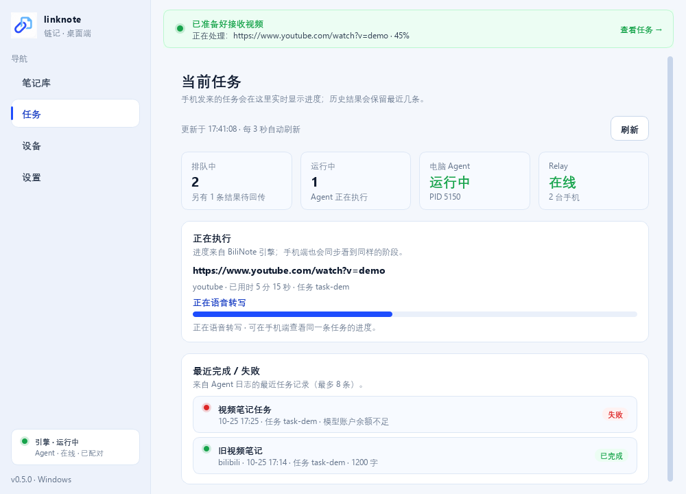
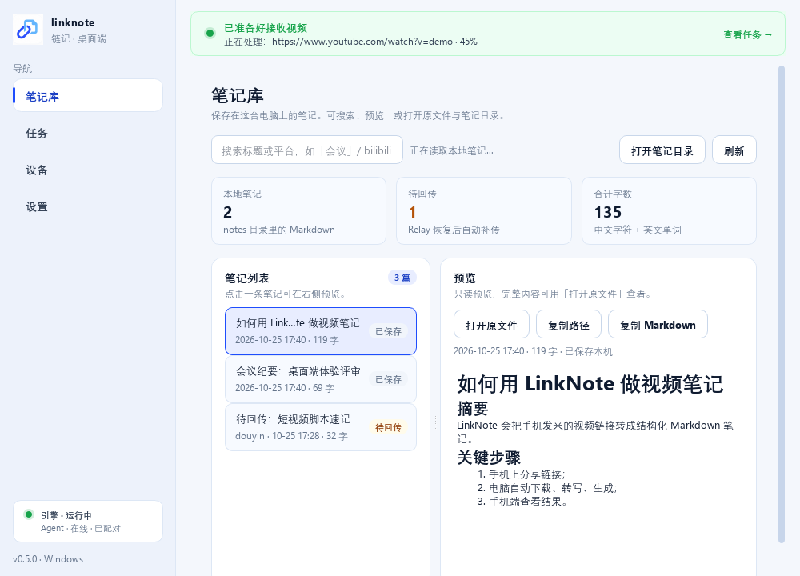
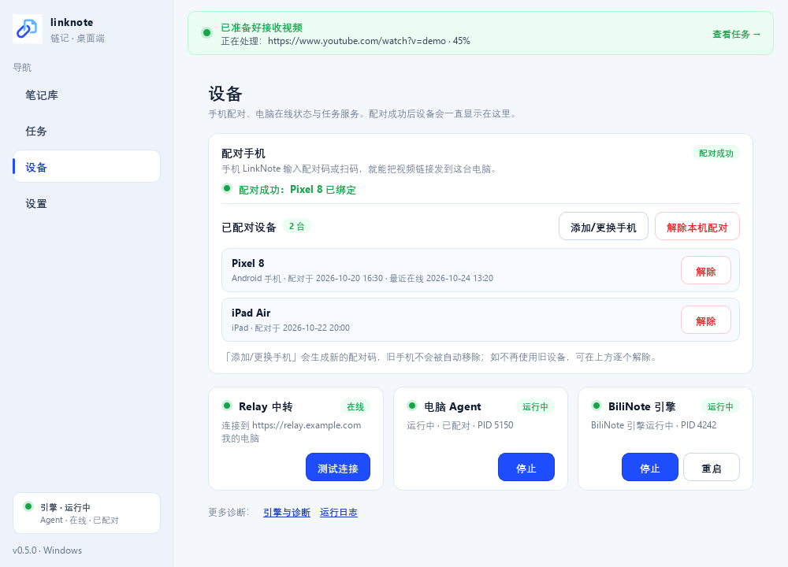

# LinkNote / 链记

手机分享视频链接 → 家里电脑的 BiliNote 生成 AI 笔记 → Markdown 回到手机。

> 工作名，可改名。定位：**BiliNote 的移动端远程入口**，不是另一个 BiliNote。
> 视频下载与默认语音转写在你的电脑完成，笔记文件保存在本机。使用在线 AI 时，必要文本直连你选择的模型服务商，密钥不经链记中继；链记中继不持久保存笔记正文（转发瞬间可见明文，尚未端到端加密）。

## 现在能跑什么

| 能力 | 状态 |
|---|---|
| Relay：配对/设备/任务 + DO WebSocket 推送 + readiness + ack persisted + Bot device 签发（v0.5.0） | ✅ 本地 53 项契约/实时测试通过 |
| PC Agent：WS 收任务、协议心跳、probe/ready 上报、笔记 ack 重试 + 本机 Telegram Bot | ✅ 248 项单测通过 |
| 手机 PWA：配对、分享、实时进度、阅读器、缓存固定/徽标、readiness、无假进度 | ✅ 10 项 Playwright 冒烟 + mock E2E 全绿 |
| 桌面客户端 v0.5.0：4 导航 + 就绪横幅 + 自动归档 + 消息入口 + 自托管 Relay 向导 | ✅ 118 项 UI smoke + 37 项 pytest |
| 真实链路：YouTube + B 站各生成一篇笔记 | ✅ 见 [E2E 报告](docs/e2e-report.md) |
| Windows 桌面安装包（内置 BiliNote 引擎） | ✅ MSI 0.5.0（自托管版），构建校验通过 |
| Android APK（Capacitor 壳 + ACTION_SEND） | ✅ 已构建（v1.3）；⚠️ 未真机验证 |
| Relay 部署 | ✅ **每个人用自己的 Cloudflare 账号/域名**，见 [自托管 Relay](docs/self-hosting.md) |

## v0.5.0 更新：自托管 Relay + 只保留 Telegram Bot（2026-10-25）

- **不再提供作者的域名/公共 Relay**：客户端默认 Relay 为空；首次向导/设置必须填自己的 Relay 地址。按 [自托管 Relay](docs/self-hosting.md) 用你自己的 Cloudflare 账号 + 域名部署，免费额度足够个人使用。
- **删除 QQ Bot**；只保留 **Telegram Bot**（本机 `getUpdates` 长轮询，凭证只存本机、不上传 Relay）。Bot 同样要求先配置自己的 Relay。
- 桌面首次向导新增「连接 Relay」步骤（测试 `/api/v1/health`）；手机 PWA 与 Relay 同源自动使用当前域名；Android APK 首次配对时手填自己的 Relay。
- 安装包、APK、源码默认配置中不再包含作者域名；`relay/wrangler.toml` 改为自托管占位符。

## v0.4.0 更新：Telegram Bot 链接入口（2026-10-24）

- 每个用户填自己的 Telegram Bot Token，bot 跑在自己的 Windows 电脑上；凭证只存本机。
- 用法：桌面 → 设置 → 消息入口 → 填 Telegram Bot Token → 测试 → 启用 → 保存（Agent 自动重启）。
- 收到链接后走现有任务管线；完成后 Telegram 回预览 + 完整 `.md` 文件。
- 命令：`/start` `/help` `/status` `/last` `/retry`；默认只处理私聊/群内 @ 消息。
- 详细步骤：[Bot 链接入口文档](docs/bot-channels.md)。

## v0.3.0 更新（2026-10-24）

- **成本**：只有手机在线时才启用 30s alarm/心跳；无手机时 Relay 不主动 ping、不写心跳 SQL；Agent 改用 WebSocket 协议 ping。修复了 v0.2 线上 `intVar` 缺省值 bug（alarm 实际 1s）。见 [成本模型](docs/cost-model.md)。
- **笔记可靠性**：`ack_note.persisted` 区分“收到”和“保存成功”；手机保存失败会让 Agent 保留 outbox 并按 30s/2min/10min 重发（最多 3 次）；手机缓存 30 篇/6MB、收藏不淘汰、显示“已保存到手机/需从电脑取回”。
- **readiness**：手机能看到“电脑在线 · 可生成”或“在线 · 需要处理 N 项”，不再把“Agent 在线”当成“能生成”。
- **桌面端**：一级导航缩为 笔记库/任务/设备/设置；顶部就绪横幅；设置页可开启 Obsidian/本地目录自动归档（补 YAML frontmatter）。
- **许可**：默认 FFmpeg 改为 BtbN LGPL shared 构建（首次运行下载），安装包附带 GPLv3/LGPLv3 全文；BiliNote 引擎仍为 MIT 编译产物。未做代码签名。
- 协议增量：[realtime-protocol v1.1](docs/realtime-protocol.md) / [v0.3 delta](docs/v0.3-protocol-delta.md)。

## Windows 桌面客户端（推荐给普通用户）

给不想折腾命令行/API 路径的人：**一个安装包，内置 BiliNote 引擎**；首次打开走包含「连接 Relay」的向导。
**使用前请先按 [自托管 Relay](docs/self-hosting.md) 部署自己的 Cloudflare Relay**——项目不再提供公共 Relay。
品牌已更新为蓝白配色 / 链条文档图标（`assets/brand/`）。

- 安装包（MSI，推荐）：`dist-desktop/LinkNote-Setup-0.5.0.msi`
  - 大小：151,510,408 字节（144.5 MB）
  - SHA256：`5C874103EB40A74CD126A34BBEB9A329BF70C9C6F67F9B83E81649054092FEAB`
  - Windows Installer per-user 安装，免管理员；由安装服务创建 `%LOCALAPPDATA%\LinkNote` 数据目录，不经过 Inno 的临时解压，适合被联想电脑管家/火绒拦截的机器
- 安装包（EXE，备用）：`dist-desktop/LinkNote-Setup-0.5.0.exe`
  - 大小：133,587,294 字节（127.4 MB）
  - SHA256：`753F1554619BB90420B7B6886D90B721CBA411184F396F1FDFBAACF7CE768106`
  - per-user 安装，免管理员，默认创建桌面/开始菜单快捷方式、默认开机自启
  - 内置 BiliNote 引擎（约 300 MB），不要求用户自己安装 BiliNote
- 主程序：`dist-desktop/LinkNote/LinkNote.exe`
  - 大小：6,740,962 字节；SHA256：`A01A4839405A0E0EE612B9DDEBA67C22B37CD013DC8701AF73BCA93E7789FCBF`（FileVersion 0.5.0.0）
- 首次向导：连接 Relay（你自己的 Cloudflare 域名）→ ffmpeg（LGPL shared，约 78MB）→ 启动引擎 → 填 LLM Key/选模型 → 下载 Whisper → 配对手机
- 主界面：笔记库（搜索/预览/打开文件）、任务、设备（配对常驻）、设置（AI/转写/引擎/日志入口；自动归档；消息入口）
- 消息入口：设置页填自己的 Telegram Bot Token；本机 Agent 直接跑 bot，凭证不上传 Relay
- 常驻系统托盘；托盘显示绿/黄/红状态；开机自启；关闭窗口即最小化
- 详细说明：[desktop/README.md](desktop/README.md)、[打包说明](desktop/packaging/README.md)









### 最终 APK（手机端可选）

- 路径：`release/LinkNote-debug.apk`
- 大小：4,701,320 字节（4.48 MiB）
- SHA256：`05F5B84E6902A1D51BB78CF712C96D774AA2A8F48DA9EAEA6C3FDA0985670F49`
- 构建时间：2026-10-25 17:39:41（Asia/Shanghai）
- 包名 `xyz.xykong.linknote`，versionCode 4 / versionName 1.3，label「链记」，minSdk 24 / targetSdk 36，debug 签名，`android:allowBackup="false"`
- 内置 PWA v0.4.0（APP_VERSION/SW_VERSION 均 0.4.0；默认 Relay 为空，配对页手填自己的 Relay）
- 分享入口：系统分享 `text/plain` → App 内收件箱预填
- 构建/安装说明见 [packaging/android/README.md](packaging/android/README.md)


## 它怎么工作

```text
手机 PWA / APK ◀── WebSocket 推送 ──▶ Cloudflare Worker + Durable Object(SQLite)
        │                                │  Hibernation 长连接；D1 只存任务元数据
        │  REST 快照兜底                  │  presence / task_updated / note 转发
        ▼                                ▼
  手机本地缓存笔记 ◀── note ── PC Agent（WebSocket，断线退避重连）
                                       │ http://127.0.0.1:8483/api
                                       ▼
                        Windows 电脑上的 BiliNote（本机，不改代码）
                     yt-dlp → ffmpeg → Whisper/Groq → 你的 LLM Key → Markdown
```

电脑不需要公网 IP，路由器不用端口映射；手机在 4G/公司网络也能用。原理与取舍见 [架构](docs/architecture.md)。

**Bot 入口（v0.5.0）**：Telegram 消息由本机 Agent 直接长轮询接收（无需公网回调），建任务仍走同一条 Relay→Agent→BiliNote 管线；笔记从本机 `notes/` 直接回发聊天，不经过 Relay 的 bot 服务。QQ Bot 已删除。

## 快速开始

### 普通用户（Windows）

0. **先用自己的 Cloudflare 账号 + 域名部署 Relay**：按 [自托管 Relay](docs/self-hosting.md) 操作（免费额度足够个人使用）。
1. 双击 `dist-desktop/LinkNote-Setup-0.5.0.msi` 安装（推荐；EXE 为备用）。
2. 首次向导填写 **你的 Relay 地址**（`https://relay.example.com`，测试通过后继续），再完成 ffmpeg → 引擎 → LLM Key → Whisper → 手机配对。
3. 手机打开 **你自己的 Relay 域名**（或安装 APK 后在配对页填写同一地址），输入配对码即可。

### 开发/本地联调

前置：Node.js 20+、[uv](https://docs.astral.sh/uv/)、本机 BiliNote 引擎（或 `desktop/build/engine`）。

```powershell
npm run setup          # 安装 relay/app 依赖、vendor、sync、本地 D1、pc-agent venv

# 1. 启动 Relay + PWA（保持运行）
npm run dev            # http://127.0.0.1:8787

# 2. 新开 PowerShell：开发模式桌面端（可不安装）
cd desktop
.venv\Scripts\python.exe -m linknote_desktop

# 或者用老式 CLI Agent：
cd pc-agent
.venv\Scripts\python.exe -m linknote_agent pair --relay http://127.0.0.1:8787
.venv\Scripts\python.exe -m linknote_agent run
```

想直接看真实生成的笔记：`assets/e2e/bilibili-note.md`、`assets/e2e/real-note.md`。

## 文档

- [桌面客户端说明](desktop/README.md)（安装/向导/架构/限制）
- [自托管 Relay](docs/self-hosting.md)（用你自己的 Cloudflare 账号/域名）
- [桌面端打包](desktop/packaging/README.md)
- [架构与取舍](docs/architecture.md)
- [Bot 链接入口（Telegram）](docs/bot-channels.md)
- [实时协议（DO/WS）v1.1](docs/realtime-protocol.md) / [v0.3 协议增量](docs/v0.3-protocol-delta.md)
- [接口契约](docs/api-contract.md)（Relay / Agent / PWA 三方唯一约定）
- [成本模型](docs/cost-model.md)（免费额度/DO 计费/压测口径）
- [v0.3.0 发布报告](docs/v0.3-release-report.md)
- [v0.5.0 发布报告（自托管 + Telegram）](docs/v0.5-release-report.md)
- [部署到 Cloudflare（进阶）](docs/deployment.md)
- [使用指南（Windows + Android）](docs/user-guide.md)
- [安全模型](docs/security.md)
- [端到端验证报告](docs/e2e-report.md)
- [Android 打包说明](packaging/android/README.md)
- [PC Agent 说明](pc-agent/README.md)

## 仓库结构

| 目录 | 说明 |
|---|---|
| `desktop/` | Windows 桌面客户端（PySide6 + 托盘 + 首次向导 + 打包） |
| `relay/` | Cloudflare Worker + D1，配对/任务/笔记 API，同时托管 PWA |
| `pc-agent/` | Windows PC Agent，调用本机 BiliNote |
| `app/` | 手机 PWA（`app/www`，Capacitor `webDir`） |
| `app/android/` | Capacitor Android 工程（含 ACTION_SEND 分享接收） |
| `packaging/android/` | 工具链安装 + APK 构建脚本、补丁、验证记录 |
| `docs/` | 架构、接口、部署、安全、E2E 报告 |
| `scripts/` | 开发/同步/UI 冒烟/图标/端到端脚本 |
| `release/` | `LinkNote-debug.apk`（构建产物，不上 git） |

## 测试

```powershell
npm --prefix relay test          # Relay 契约/实时 53 项（自动起 wrangler dev）
node scripts\ui-smoke.mjs        # PWA UI 10 项（需 relay 在 8787 且 UI_RELAY 指向它）
cd pc-agent; .venv\Scripts\python.exe -m pytest -q   # Agent 248 项（含 Telegram Bot mock）
cd desktop; .venv\Scripts\python.exe -m linknote_desktop.ui._smoke   # 桌面 118 项 smoke
cd desktop; .venv\Scripts\python.exe -m pytest tests -q              # 桌面 37 项 pytest
npm run check                    # 常用组合（Agent venv 存在时）
```

真实链路验证需要本机 BiliNote 可用，步骤见 [E2E 报告](docs/e2e-report.md)。

## 成本

- 个人 1–3 台常在线：Cloudflare Workers + D1 + DO 免费额度内 **$0/月**（域名自备）。
- **免费额度是硬上限**：DO 10 万请求/天 + 10 万行写/天，超限当天直接报错，不是账单。v0.2.x 的 30s 心跳约 **32 台常在线**就到上限。
- v0.3.0 起只在手机在线时才心跳，估算 1,000 台常在线仍可留在免费额度内；生产/内测建议开 Workers Paid **$5/月** 兜底。
- 不产生云转写/云 LLM 费用；这部分走你自己的 BiliNote 配置。
- 明细与算法见 [成本模型](docs/cost-model.md)。

## 已知限制

- **电脑必须常开并运行 Agent**；电脑离线时任务排队，恢复后继续。
- **没有推送**：App 不在前台时不会提醒，回到前台自动刷新（后续可接邮件/微信服务号）。
- **Relay 在转发瞬间能看到 Markdown 明文，但正文不落 D1/DO**；E2E 加密是后续项。
- 配对创建/领取尚未做 IP 限流；公网大规模开放前需补。
- **安装包未做代码签名**：SmartScreen 会提示“未知发布者”；本机 Inno EXE 仍被安全软件拦（exit 5），分发请用 MSI。
- **FFmpeg 首次运行需联网**从 GitHub/BtbN 下载 LGPL shared 构建（约 78MB，解压 177MB）；下载失败可在向导跳过或手动指定本机 ffmpeg。
- 联想电脑管家会在部分机器上删除 HKCU Run 自启项；需要在联想启动项管理里允许 LinkNote（MSI 写入本身正确）。
- Android APK 尚未真机验证；PWA 在 Android Chrome 上功能完整。
- B 站/YouTube 等平台的下载能力与 ToS 风险由 BiliNote 和用户自己承担；不要公开分发受版权保护的内容。

## License

本仓库代码 MIT。BiliNote 上游为 MIT；仓库不包含也不修改其源码。Windows 桌面安装包可选内置**编译后**的 BiliNote 引擎（MIT，未修改源码，独立进程 + HTTP），也可以 `-SkipEngine` 不内置、使用本机已装的 BiliNote。详见 `NOTICE`。


