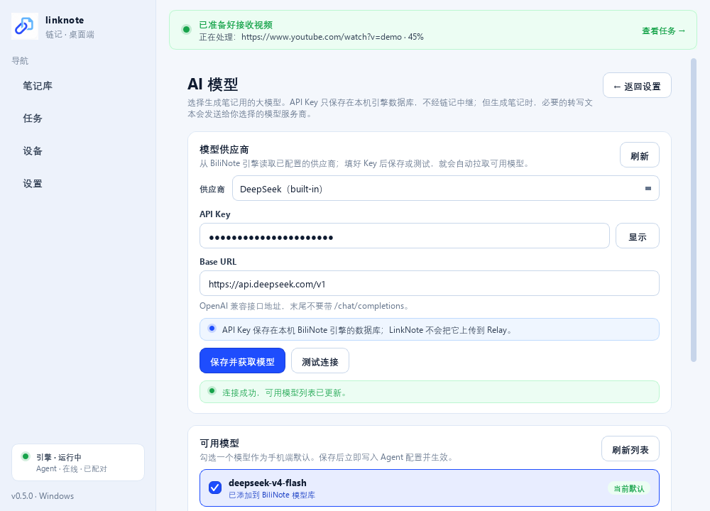
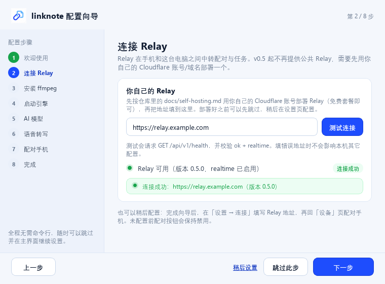
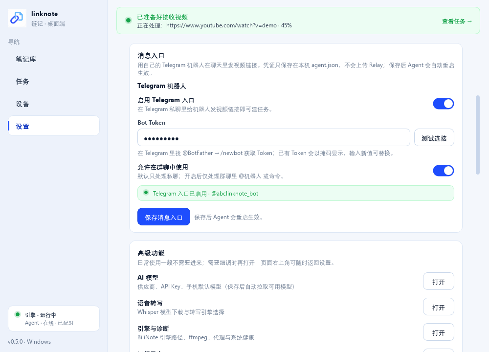

# LinkNote Desktop（Windows 客户端）

面向普通用户的 LinkNote 桌面端：**安装后即用**，不需要命令行、不需要手动安装 BiliNote。

- 安装包：`dist-desktop/LinkNote-Setup-0.5.0.exe`（per-user，免管理员）
- 主程序：`dist-desktop/LinkNote/LinkNote.exe`
- 内置 BiliNote 引擎：安装包默认包含（约 300 MB，BiliNote MIT）
- 系统托盘常驻、开机自启、状态绿/黄/红
- **Relay 自托管**：v0.5 起不内置任何公共 Relay；先按 [`docs/self-hosting.md`](../docs/self-hosting.md) 用你自己的 Cloudflare 账号/域名部署，再在首次向导 / 设置页填写地址
- 首次启动 8 步配置向导：Relay → ffmpeg → 引擎 → AI Key → Whisper → 手机配对
- 4 个主导航页：**笔记库 / 任务 / 设备 / 设置**（AI 模型、语音转写、引擎与诊断、日志收进设置页）
- 顶部就绪横幅：绿色「已准备好接收视频」/ 黄红「需要处理：…」（含「未配置 Relay」阻塞项），点击直接跳到要处理的页面
- 消息入口：设置页填写**自己的** Telegram Bot Token，测试连接、启用开关；凭证只存本机 agent.json
- AI 模型：保存或测试 API Key 后**自动拉取可用模型**，勾选即写回 Agent 生效（无需手动刷新/重启）
- 配对常驻：配对成功后已配对设备一直显示，可添加/更换手机、逐个解除或解除本机配对
- Obsidian/本地目录自动归档：把 notes 里的 Markdown 复制到 Obsidian 仓库并补 YAML frontmatter（可开关、选目录、立即导出）
- 任务/笔记库：手机任务的实时进度与最近结果、本机留档 Markdown 的搜索/预览


| 任务 | 设备 |
|---|---|
|  |  |

| 笔记库 | AI 模型（设置 → 高级功能） |
|---|---|
|  |  |

| 连接 Relay（首次向导） | 消息入口（Telegram） |
|---|---|
|  |  |

| 首次配对（向导） |
|---|
|  |

## 1. 用户怎么用

1. **先部署自己的 Relay**：按 [`docs/self-hosting.md`](../docs/self-hosting.md) 用你自己的 Cloudflare 账号创建 D1 + 部署 Worker + 绑定域名，得到一个 `https://你的域名`。桌面端不再连接作者的任何公共地址。
2. 双击 `LinkNote-Setup-0.5.0.msi`（推荐；Windows Installer，免管理员）。
   - 如果机器上装了联想电脑管家/火绒，它们可能拦截 Inno 版 `LinkNote-Setup-0.5.0.exe` 的临时解压；MSI 由 Windows Installer 服务创建目录，通常可通过。
3. 首次打开按向导：
   - **连接 Relay**：填写 `https://你的-relay域名`，点「测试连接」确认 `/api/v1/health` 返回 ok + realtime（也可以稍后配置，但配对前必须填好）
   - 自动下载 FFmpeg **LGPL shared** 构建（BtbN，zip 约 82 MB / 解压约 177 MB，只需一次）
   - 启动内置 BiliNote 引擎
   - 选择 DeepSeek/OpenAI 等供应商，粘贴自己的 API Key 并测试
   - 选择 Whisper 模型并下载（默认 small，也可用 tiny/base）
   - 生成配对码/二维码，手机 LinkNote 输入或扫码
4. 之后程序常驻托盘；手机分享视频链接，电脑自动生成 Markdown 回传手机。
5. 主界面（4 个一级页面）：
   - **笔记库**：本机 `notes` 目录里的 Markdown（回传失败/过大的笔记会自动留档），支持按标题/平台搜索、Markdown 预览、打开原文件/目录、复制路径；
   - **任务**：Agent 正在处理的任务、引擎实时阶段/进度、Relay 队列、最近完成/失败；
   - **设备**：配对面板常驻 + Relay/Agent/引擎连接状态卡；
   - **设置**：连接（Relay 地址 + 测试 Relay）、消息入口、归档、启动行为、生成参数、本机路径；「高级功能」里可进入 AI 模型 / 语音转写 / 引擎与诊断 / 日志（页面右上角可返回）。
   - 顶部横幅会提示「已准备好接收视频」或「需要处理：…」，点击直接跳到对应页面（未配置 Relay 时优先提示）。
   - **消息入口**：设置 → 消息入口，填自己的 Telegram Bot Token（@BotFather → `/newbot`），测试连接后打开开关保存；保存会写本机 `agent.json` 并重启 Agent 生效。凭证在 UI 掩码显示、不写日志。
   - **Obsidian 自动归档**：设置 → 笔记自动归档，选择 Obsidian 仓库或任意本地目录后，新笔记会复制过去并补 `title/source_url/platform/created_at/model/app_version` frontmatter；已存在文件不会重复导出。

关闭窗口默认最小化到托盘；右键托盘可打开主界面、暂停任务、重启引擎、退出。开机自启默认开启，可在设置关闭。

## 2. 它管理什么

| 功能 | 实现 |
|---|---|
| BiliNote 引擎 | 安装包内置 clean engine；桌面端启动/停止/探测/自动复用已运行实例 |
| Relay（自托管） | 默认 Relay 为空；首次向导 / 设置页填写自己部署的地址，测试 `GET /api/v1/health`（ok + realtime）；保存写 `agent.json` 并重启 Agent；未配置时配对禁用、就绪横幅提示 |
| ffmpeg | 自动检测系统 ffmpeg；没有则从 **BtbN FFmpeg-Builds 下载 win64 LGPL shared 构建**（默认 `ffmpeg-master-latest-win64-lgpl-shared.zip`）解压到 `%LOCALAPPDATA%\LinkNote\ffmpeg`（保留同目录 DLL），通过 `FFMPEG_BIN_PATH` 注入引擎；也可手动指定本机 ffmpeg |
| LLM 供应商/Key | 通过 BiliNote `/get_all_providers`、`/update_provider`、`/connect_test` 管理；Key 存在本机引擎数据库 |
| 模型选择 | `/model_list` + `/model_list/{provider}`（动态可用模型 + 内置回退）；UI 勾选后写 `config.provider_id/model_name`，Agent 运行时自动重启生效 |
| 当前任务 | controller 后台快照：Agent 日志任务事件 + Relay `/agent/me` 队列 + BiliNote `/task_status` 实时进度；3 秒自动刷新 |
| 笔记库 / 历史笔记 | 扫 `%LOCALAPPDATA%\LinkNote\notes\*.md` 与 outbox 待回传记录；标题/平台搜索、只读预览、打开/复制 |
| 自动归档 | 扫描 notes 新 Markdown → 复制到 `archive_dir`（Obsidian vault 或本地目录），补 YAML frontmatter（title/source_url/platform/created_at/model/app_version）；目标已存在则跳过，幂等 |
| 消息入口 | 设置页配置用户自己的 Telegram Bot Token；controller 提供 getMe 连通性测试（不打印 token）；保存写 `agent.json` 并重启 Agent 生效 |
| 就绪横幅 | 由 Relay 配置、Agent 运行、引擎、ffmpeg、模型配置与任务快照计算；绿色「已准备好接收视频」/ 黄红「需要处理：…」并可点击跳转 |
| Whisper | `/transcriber_config`、`/transcriber_download`、`/transcriber_models_status`；默认 HF 镜像 `hf-mirror.com`，可改 |
| 手机配对 | 桌面端创建配对码/二维码，Agent 自动轮询 Relay 直到手机领取；成功后设备列表常驻，可添加/更换/解除 |
| 常驻 | PySide6 QSystemTrayIcon + 独立 Agent 子进程 + HKCU Run 自启 |
| 日志 | `%LOCALAPPDATA%\LinkNote\logs`；引擎/Agent 页可查看 |
| 数据 | `%LOCALAPPDATA%\LinkNote`（settings/agent/logs/notes/outbox），卸载保留 |

## 3. 隐私说明（准确版）

- 视频下载与默认语音转写在你的电脑完成。使用在线 LLM 时，必要的转写文本会发送给你选择的模型服务商；使用 Groq 等云转写时音频也会发送给相应服务商。
- 手机 Relay 只中转：视频链接、任务状态、最终 Markdown（转发瞬间可见明文，尚未端到端加密）。
- **最终 Markdown 不保存在 Relay 的 D1 / Durable Object 数据库中**：只经 WebSocket 转发到手机本地缓存；Agent 本地保留 notes，供手机离线时按需重发。
- **Relay 由你自己部署和管理**：数据保存在你 Cloudflare 账号下的 D1；作者不运营也不接触你的 Relay。
- 桌面端不上传本机路径、日志或引擎配置。
- 如果启用 Telegram 消息入口，聊天内容与回传的笔记会经过 Telegram 平台云（非端到端加密）；Bot Token 只存本机 `agent.json`。

## 4. 系统要求

- Windows 10/11 x64
- 安装包约 127 MB，安装后约 430 MB（不含 Whisper 模型）
- 首次配置另需下载：ffmpeg 约 100 MB + Whisper small 约 460 MB（可选 tiny 约 75 MB）
- 需要网络访问**你自己部署的 Relay 域名**、`api.deepseek.com`（或你选的 LLM）、`hf-mirror.com`/HuggingFace
- 需要一个自己的 Cloudflare 账号 + 域名来部署 Relay（免费套餐即可，见 [`docs/self-hosting.md`](../docs/self-hosting.md)）
- 电脑需要保持开机/不休眠，手机才能随时发任务

## 5. 开发运行

```powershell
cd desktop
uv venv .venv --python 3.11
uv pip install --python .venv\Scripts\python.exe -e ..\pc-agent -e ".[dev]"

# 开发运行（需要本机 BiliNote 引擎，或先用打包引擎 staging）
.venv\Scripts\python.exe -m linknote_desktop

# 无 UI 自测
.venv\Scripts\python.exe -m linknote_desktop.ui._smoke

# 数据层单测（任务事件解析 / 笔记库扫描 / 归档 frontmatter 与幂等）
.venv\Scripts\python.exe -m pytest tests -q

# 真实链路手工 E2E（独立临时 LOCALAPPDATA，不污染用户配置）
.venv\Scripts\python.exe -m tests.manual_e2e_desktop
```

## 6. 打包

```powershell
# 生成干净引擎 staging（默认 C:\app\bilinote）
powershell -ExecutionPolicy Bypass -File desktop\packaging\stage-engine.ps1

# PyInstaller + Inno Setup + 安装/卸载验证
powershell -ExecutionPolicy Bypass -File desktop\packaging\build-desktop.ps1
```

详细工具链、验证记录、签名步骤见 [`packaging/README.md`](packaging/README.md)。

## 7. 架构

```text
LinkNote.exe (PySide6)
├── MainWindow / TrayIcon        # 4 一级页 + 4 二级页 + 就绪横幅 + 向导 + 托盘
├── DesktopController            # Qt 信号 + 后台线程池
│   ├── EngineManager            # BiliNoteBackend.exe 启停/探测
│   ├── AgentProcess             # LinkNote.exe --agent-worker 子进程（现有 linknote_agent）
│   ├── FFmpegManager            # 检测/下载/解压
│   ├── RelayService             # 配对/设备状态（复用 RelayClient）
│   ├── 数据快照（任务/笔记库）    # Agent 日志解析 + notes/outbox 扫描，后台线程，不阻塞 GUI
│   ├── 自动归档                 # notes → Obsidian/本地目录 + frontmatter，幂等
│   └── Bot 凭证测试              # Telegram getMe（错误不带 token）
└── engine\BiliNoteBackend.exe   # 安装包内置
```

- UI 不是 WebView，是原生 Qt；桌面端蓝白品牌色。
- 设备页与首次配置向导共用 `ui/pairing_panel.py` 的配对组件，保证两处体验一致。
- Agent 复用 `pc-agent` 的成熟逻辑，在子进程运行，GUI 不阻塞；Telegram Bot 的实际轮询/投递由 pc-agent v0.5 实现，桌面端负责凭证配置、测试与开关。
- 引擎复用 BiliNote v2.4.4 HTTP API，不修改其源码。

## 8. 已知限制 / 发布前 TODO

- **安装包未代码签名**：Windows SmartScreen 会提示未知发布者；正式分发需要 EV/OV 代码签名证书。
- 无自动更新（后续接 GitHub Releases/自有更新服务）。
- **从 v0.4 升级**：`settings.json` / `agent.json` 里保存的作者旧 Relay（含旧 `*.workers.dev` 默认）会在加载/保存/写 Agent 配置时自动清空，需要在向导或设置页重新填写自己的 Relay 地址；不会再连接旧域名。
- LLM Key 仍需用户自备（BYOK）；对普通用户这是最大门槛，后续可评估托管模型/额度套餐。
- Relay 目前是单区域 Worker + D1，公开大规模分发前需限流/监控/备份。
- 内置引擎版本随安装包版本走；升级 LinkNote 时需同步升级引擎。
- 安装包内引擎来自本地 BiliNote 构建；公开分发前需确认上游版本/许可与更新策略。
- Markdown 不落 Relay 数据库；转发瞬间 Relay 可见明文，端到端加密为后续项。
- Telegram 消息会经过 Telegram 平台云（非端到端加密）；Telegram 在中国大陆通常需自备代理。
## 9. 第三方许可与 FFmpeg

- 安装目录内 `LICENSE`（LinkNote MIT）、`NOTICE`（第三方组件说明）、
  `licenses\GPL-3.0.txt`、`licenses\LGPL-3.0.txt`（LGPL-3.0 以 GPL-3.0 为基础；具体下载到的 LGPL 构建以其自带 LICENSE.txt 为准）。
- **FFmpeg 不随安装包分发**：首次配置向导从
  `https://github.com/BtbN/FFmpeg-Builds/releases/download/latest/ffmpeg-master-latest-win64-lgpl-shared.zip`
  （BtbN FFmpeg-Builds，win64 **LGPL shared**）下载，解压到
  `%LOCALAPPDATA%\LinkNote\ffmpeg\bin`（`ffmpeg.exe` + 同目录 DLL；
  构建自带 LICENSE 保存为同级的 `FFMPEG-LICENSE.txt`）。
- 默认下载的是 **LGPL** 构建，不再主动下载 gyan.dev 的 GPLv3 essentials；
  如果用户手动指定本机 GPL 构建，由用户自行承担该构建的 GPL 义务
  （LinkNote 只把它作为独立进程调用）。
- PyQt/PySide6（LGPLv3）、Python（PSF）、PyInstaller（GPLv2 + 例外）、
  BiliNote 引擎（MIT）等第三方说明见仓库根 `NOTICE`。

